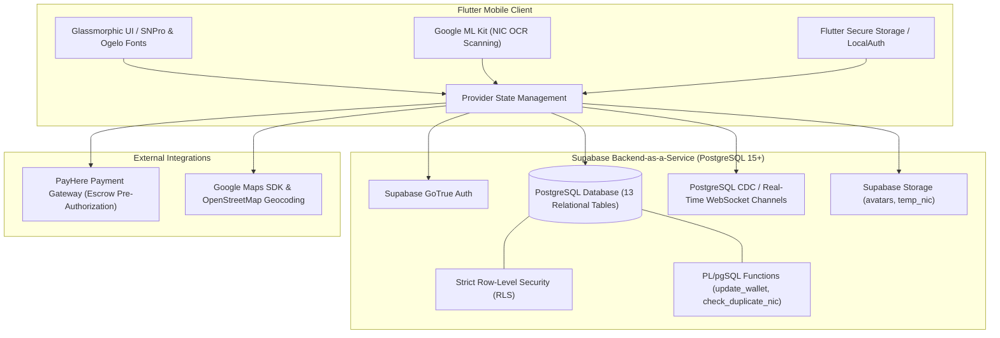

# Circl | Hyper-Local Community Sharing & Peer-to-Peer Microservices

[](https://flutter.dev/)
[](https://dart.dev/)
[](https://supabase.com/)
[](https://www.payhere.lk/)
[-blue)](https://supabase.com/docs/guides/auth/row-level-security)

**Circl** is a hyper-local Flutter mobile application built for Sri Lanka to power peer-to-peer resource sharing, tool borrowing, community micro-tasks, and neighbor-to-neighbor services. Designed to foster collaborative consumption and trust within neighborhoods, Circl replaces informal borrowing and manual tracking with escrow payments, biometric security, on-device OCR identity verification, and interactive map discovery.

---

## Architecture & System Design



---

## Core Features

### 1. Hyper-Local Discovery & Dynamic Proximity
* **Interactive Map Exploration:** Browse active borrow requests, rental listings, and community tasks with real-time radius filtering (1 km – 20 km) powered by Google Maps.
* **Geofenced Feeds:** Location-aware request feed displaying items nearest to the user using device GPS.

### 2. Multi-Tier Resource Sharing
* **Free Borrowing:** Lend and borrow household items, textbooks, and appliances for zero cost.
* **Paid Equipment Rentals:** Rent power tools, cameras, and equipment with automated daily/weekly price calculations.
* **Community Tasks & Services:** Request physical assistance, pet care, or neighborhood chores with custom compensation.

### 3. Trust, Security & Identity Verification
* **On-Device OCR NIC Scanning:** Machine learning text recognition via Google ML Kit to parse Sri Lankan National Identity Cards.
* **Salted SHA-512 Hashing:** National Identity Card numbers are never stored in plaintext—only irreversible cryptographic hashes are verified against duplicate fraud.
* **Biometric App Lock:** Fingerprint and Face Unlock security integrated via `local_auth` and hardware keychains via `flutter_secure_storage`.

### 4. Escrow Financial Engine & PayHere Integration
* **Two-Phase Payment Escrow:** Borrower funds (Rental Fee + Security Deposit + 5% Platform Fee) are pre-authorized and securely held in escrow via PayHere during active rentals.
* **Automatic Split & Deposit Refund:** Upon safe item return, the deposit is instantly credited back to the borrower's wallet, and provider earnings are transferred.
* **Double-Entry Ledger:** Full transaction audit trail (`ledger_entries`) guaranteeing financial consistency.

### 5. Real-Time Chat & Handover Timeline
* **PostgreSQL Realtime Channels:** Instant messaging and status broadcasts between borrowers and lenders.
* **Transaction Milestone Tracker:** Step-by-step transaction timeline from negotiation and payment hold to item dispatch, handoff, and return.

### 6. Gamification & Community Governance
* **Aura Points System:** Tiered reputation levels (Bronze, Silver, Gold, Platinum) earned through successful returns and positive community reviews.
* **Peer Reviews & Ratings:** 5-star rating system with verified transaction badges.
* **Admin Dispute & Moderation Center:** Complete administrative workflow to audit disputed returns, inspect proof documentation, and enforce account actions.

---

## Database Architecture

The backend runs on Supabase (PostgreSQL 15+) with strict Row-Level Security (RLS) policies protecting all records:

| Table | Description |
|---|---|
| `profiles` | Extended user identity, aura points, rating, and wallet balance. |
| `requests` | Community sharing listings with coordinates, radius, and rental terms. |
| `transactions` | Active lifecycle, escrow states, and agreement parameters. |
| `transaction_timeline`| Audit log of transaction status updates and notes. |
| `messages` | Real-time chat messages between parties in an active transaction. |
| `wallets` | In-app user balances with atomic balance updates. |
| `ledger_entries` | Immutable ledger logging escrow holds, refunds, and earnings. |
| `payments` | Gateway callback records and authorization tracking. |
| `nic_verifications` | Salted SHA-512 identity hashes and verification states. |
| `reviews` | Double-blind peer feedback after transaction completion. |
| `reports` | User safety reports for administrative moderation. |
| `disputes` | Conflict escalation records for damaged items or delayed returns. |
| `notifications` | Real-time WebSocket broadcasts and persistent user alerts. |

---

## Getting Started

### Prerequisites

* [Flutter SDK](https://docs.flutter.dev/get-started/install) (`^3.11.0` or higher)
* [Dart SDK](https://dart.dev/get-dart) (`^3.0.0` or higher)
* Android Studio / VS Code with Flutter extension
* A free [Supabase](https://supabase.com/) account
* (Optional) [PayHere Sandbox Account](https://www.payhere.lk/) for payment testing

---

### Step 1: Clone the Repository

```bash
git clone https://github.com/YourUsername/Circl.git
cd Circl
```

---

### Step 2: Supabase Database Setup

1. Log in to your [Supabase Dashboard](https://supabase.com/dashboard) and create a new project.
2. In the left navigation, open **SQL Editor**.
3. Open `supabase/schema.sql` from this repository, copy its contents, paste them into the SQL Editor, and click **Run**.
4. This script automatically provisions:
   * All 13 core database tables with proper foreign keys and indexes.
   * Stored procedures (`update_wallet`, `check_duplicate_nic`, `get_available_requests`).
   * Row-Level Security (RLS) policies.
   * Automatic user profile and wallet creation triggers on signup.
   * Public storage buckets (`avatars` and `temp_nic`).

---

### Step 3: Configure Environment Variables

The project uses compile-time environment injection to keep secrets out of source code.

1. Create a local `.env` file from the provided template:
   ```bash
   cp .env.example .env
   ```
2. Open `.env` and fill in your Supabase and PayHere credentials:
   ```env
   # Supabase Settings (Project Settings -> API)
   SUPABASE_URL=https://your-project-ref.supabase.co
   SUPABASE_ANON_KEY=your-supabase-anon-public-key

   # PayHere Settings (Sandbox or Live)
   PAYHERE_MERCHANT_ID=your_merchant_id
   PAYHERE_SECRET=your_merchant_secret
   PAYHERE_NOTIFY_URL=https://your-project-ref.supabase.co/functions/v1/payhere-webhook

   # Security Pepper (Random salt string for SHA-512 hashing)
   NIC_PEPPER=your_custom_secret_salt
   ```

> [!NOTE]
> `.env` is explicitly ignored in `.gitignore` to prevent credentials from ever leaking into Git history.

---

### Step 4: Install Dependencies

```bash
flutter pub get
```

---

### Step 5: Run the Application

Run the application with environment configuration loaded:

```bash
flutter run --dart-define-from-file=.env
```

To build a release APK:

```bash
flutter build apk --release --dart-define-from-file=.env
```

---

## Security & Best Practices

* **Zero Hardcoded Secrets:** Credentials are read at build time via `EnvConfig` using `String.fromEnvironment()`.
* **Row-Level Security (RLS):** Database operations are constrained at the PostgreSQL engine level; users cannot read or write records belonging to other users.
* **Cryptographic Privacy:** National Identity Card numbers are transformed into salted SHA-512 hashes before transmission, making identity data mathematically irreversible.
* **Escrow Funds Protection:** Payments are authorized with funds held securely in escrow and released only upon bilateral confirmation or administrative resolution.

---

## License

This project is licensed under the [MIT License](LICENSE).
