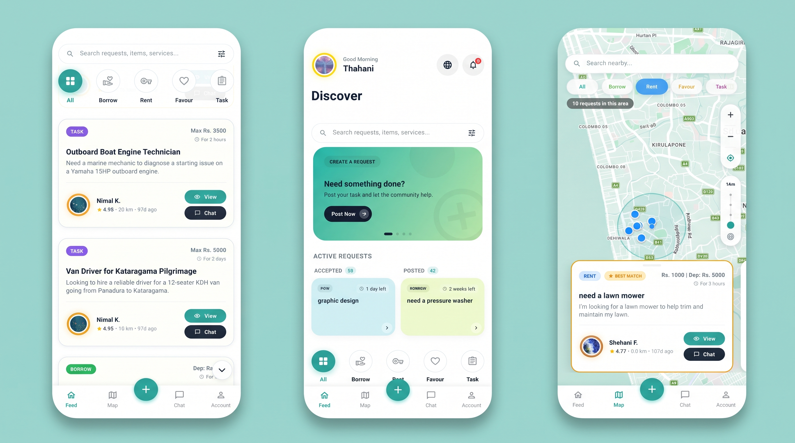

# Circl | Community Sharing & Peer-to-Peer Microservices

[](https://flutter.dev/)
[](https://www.android.com/)
[](https://dart.dev/)
[](https://supabase.com/)
[](https://www.payhere.lk/)
[-blue)](https://supabase.com/docs/guides/auth/row-level-security)

**Circl** is a Flutter mobile application built for Sri Lanka to power peer-to-peer resource sharing, tool borrowing, community micro-tasks, and neighbor-to-neighbor services. Designed to foster collaborative consumption and trust within neighborhoods, Circl replaces informal borrowing and manual tracking with escrow payments, biometric security, on-device OCR identity verification, and interactive map discovery.

---

## Core Features

- **Interactive Map Discovery:** Browse and locate nearby item requests, equipment rentals, and community tasks with real-time radius filtering via Google Maps.
- **Multi-Tier Resource Sharing:** Supports free household item borrowing, paid equipment rentals with duration calculators, and community micro-tasks.
- **On-Device OCR NIC Scanning:** Fast, automated Sri Lankan National Identity Card text extraction powered by Google ML Kit.
- **Salted SHA-512 Privacy Hashing:** Identity numbers are never stored in plaintext—only non-reversible cryptographic hashes prevent duplicate accounts.
- **PayHere Escrow Protection:** Pre-authorizes and securely holds borrower funds (rental fee, deposit, 5% platform fee) until items are safely returned.
- **In-App Wallet & Double-Entry Ledger:** Automated instant deposit refunds and provider earnings tracking with atomic balance synchronization.
- **Real-Time Chat & Milestone Tracking:** Live messaging via Supabase Realtime channels with status updates from negotiation to return.
- **Biometric Security:** Hardware-backed fingerprint and Face Unlock protection via `local_auth` and `flutter_secure_storage`.
- **Aura Reputation & Peer Reviews:** Tiered community credibility levels (Bronze, Silver, Gold, Platinum) with double-blind 5-star ratings.
- **Admin Dispute & Moderation Center:** Comprehensive administrative workflow to resolve return disputes, inspect evidence, and manage reports.

---

## Screenshots



---

## Database Architecture

The backend runs on Supabase (PostgreSQL 15+) with strict Row-Level Security (RLS) policies protecting all records:

| Table | Description |
|---|---|
| `profiles` | Extended user identity, aura points, rating, and wallet balance. |
| `requests` | Community sharing listings with coordinates, radius, and rental terms. |
| `transactions` | Active lifecycle, escrow states, and agreement parameters. |
| `transaction_timeline`| Audit log of transaction status updates and notes. |
| `messages` | Real-time chat messages between parties in an active transaction. |
| `wallets` | In-app user balances with atomic balance updates. |
| `ledger_entries` | Immutable ledger logging escrow holds, refunds, and earnings. |
| `payments` | Gateway callback records and authorization tracking. |
| `nic_verifications` | Salted SHA-512 identity hashes and verification states. |
| `reviews` | Double-blind peer feedback after transaction completion. |
| `reports` | User safety reports for administrative moderation. |
| `disputes` | Conflict escalation records for damaged items or delayed returns. |
| `notifications` | Real-time WebSocket broadcasts and persistent user alerts. |

---

## Getting Started

### Prerequisites

* [Flutter SDK](https://docs.flutter.dev/get-started/install) (`^3.11.0` or higher)
* [Dart SDK](https://dart.dev/get-dart) (`^3.0.0` or higher)
* Android Studio / VS Code with Flutter extension
* A free [Supabase](https://supabase.com/) account
* (Optional) [PayHere Sandbox Account](https://www.payhere.lk/) for payment testing

---

### Step 1: Clone the Repository

```bash
git clone https://github.com/AsfaThahani/Circl.git
cd Circl
```

---

### Step 2: Supabase Database Setup

1. Log in to your [Supabase Dashboard](https://supabase.com/dashboard) and create a new project.
2. In the left navigation, open **SQL Editor**.
3. Open `supabase/schema.sql` from this repository, copy its contents, paste them into the SQL Editor, and click **Run**.
4. This script automatically provisions:
   * All 13 core database tables with proper foreign keys and indexes.
   * Stored procedures (`update_wallet`, `check_duplicate_nic`, `get_available_requests`).
   * Row-Level Security (RLS) policies.
   * Automatic user profile and wallet creation triggers on signup.
   * Public storage buckets (`avatars` and `temp_nic`).

---

### Step 3: Configure Environment Variables

The project uses compile-time environment injection to keep secrets out of source code.

1. Create a local `.env` file from the provided template:
   ```bash
   cp .env.example .env
   ```
2. Open `.env` and fill in your Supabase and PayHere credentials:
   ```env
   # Supabase Settings (Project Settings -> API)
   SUPABASE_URL=https://your-project-ref.supabase.co
   SUPABASE_ANON_KEY=your-supabase-anon-public-key

   # PayHere Settings (Sandbox or Live)
   PAYHERE_MERCHANT_ID=your_merchant_id
   PAYHERE_SECRET=your_merchant_secret
   PAYHERE_NOTIFY_URL=https://your-project-ref.supabase.co/functions/v1/payhere-webhook

   # Security Pepper (Random salt string for SHA-512 hashing)
   NIC_PEPPER=your_custom_secret_salt
   ```

> [!NOTE]
> `.env` is explicitly ignored in `.gitignore` to prevent credentials from ever leaking into Git history.

---

### Step 4: Install Dependencies

```bash
flutter pub get
```

---

### Step 5: Run the Application

Run the application with environment configuration loaded:

```bash
flutter run --dart-define-from-file=.env
```

To build a release APK:

```bash
flutter build apk --release --dart-define-from-file=.env
```

---

## Security & Best Practices

* **Zero Hardcoded Secrets:** Credentials are read at build time via `EnvConfig` using `String.fromEnvironment()`.
* **Row-Level Security (RLS):** Database operations are constrained at the PostgreSQL engine level; users cannot read or write records belonging to other users.
* **Cryptographic Privacy:** National Identity Card numbers are transformed into salted SHA-512 hashes before transmission, making identity data mathematically irreversible.
* **Escrow Funds Protection:** Payments are authorized with funds held securely in escrow and released only upon bilateral confirmation or administrative resolution.

---

## License

Copyright © 2026 Asfa Thahani. All Rights Reserved.

This project is proprietary and confidential. Published strictly for personal portfolio demonstration and recruitment evaluation. Unauthorized commercial use, reproduction, modification, or redistribution is strictly prohibited. See [LICENSE](LICENSE) for full legal terms.
